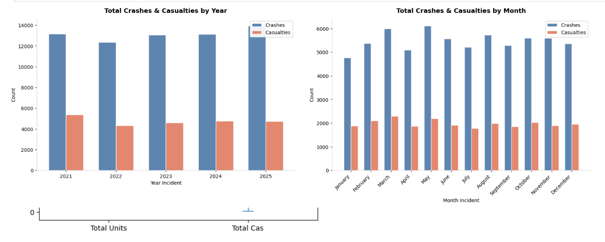
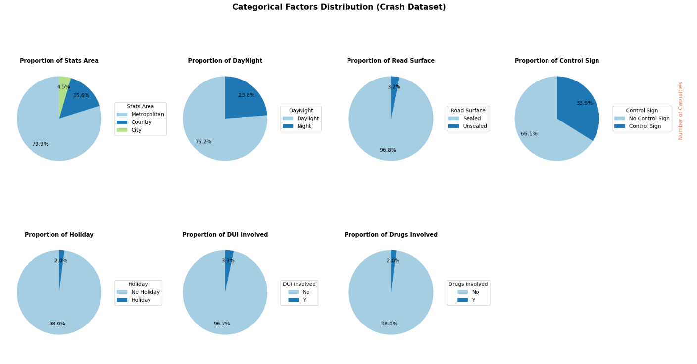
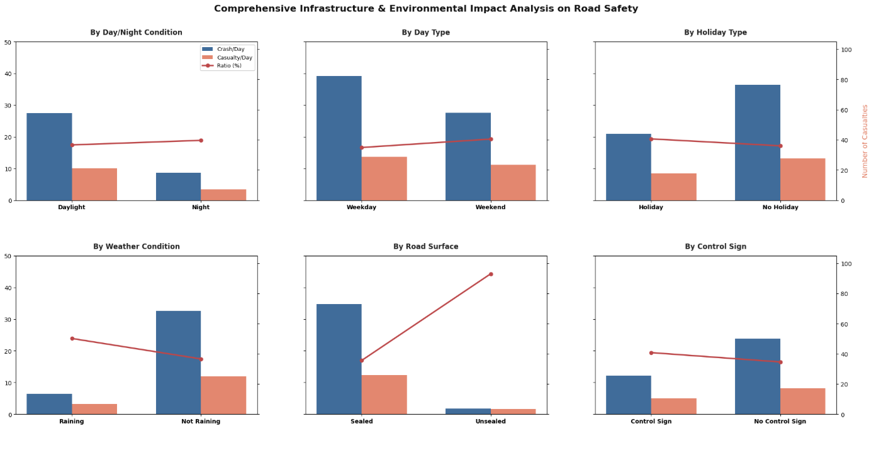
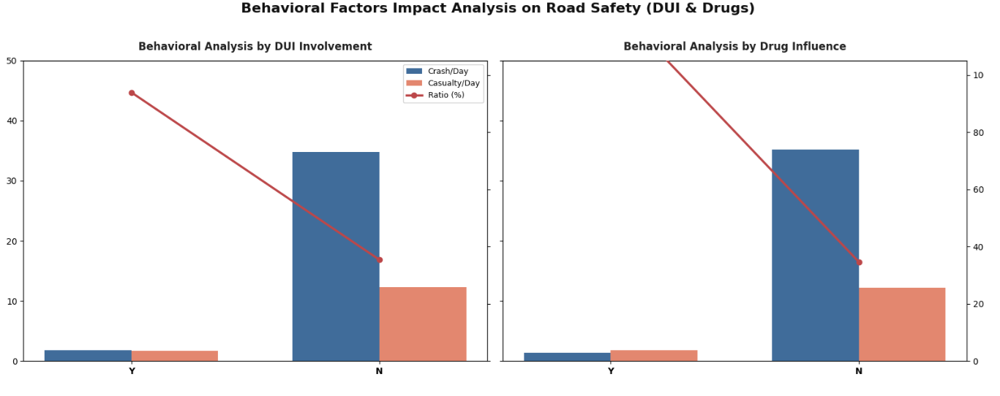
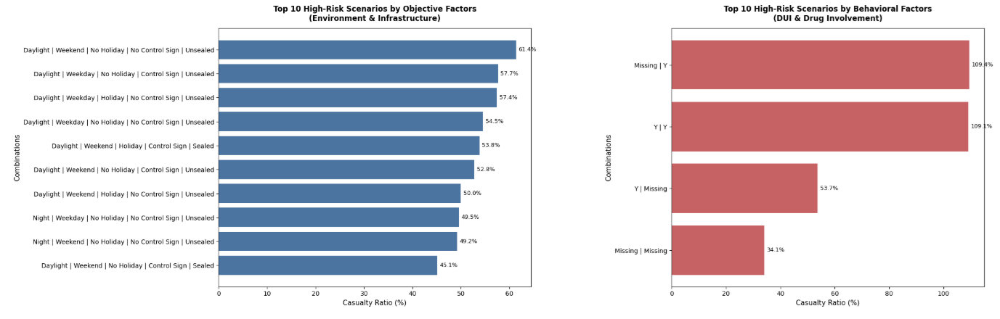
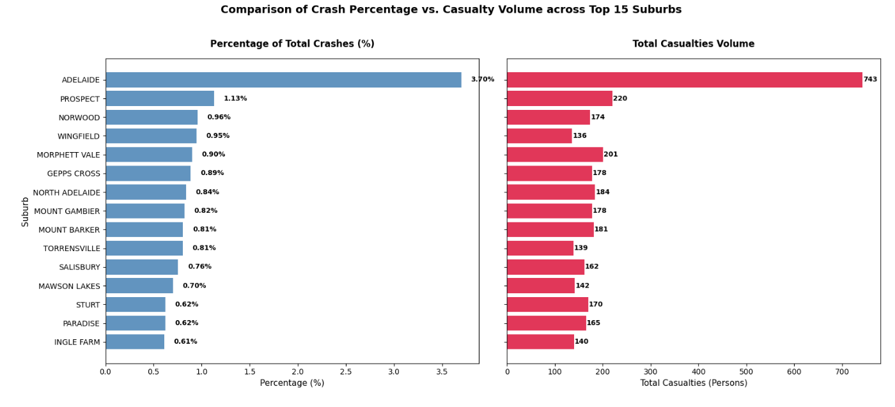

## 📌 Project Overview & Analytical Approach

Analyzed multi-year South Australia crash and casualty data in Python using statistical and visual workflows (pandas, numpy, scipy, matplotlib, seaborn). By separating incident frequency from casualty severity across time, location, road conditions, and driver behavior, the project isolates factors driving severe harm rather than just high-volume hotspots.

---

## 🔄 Data Workflow & Analytical Steps

---
### 1. Data Ingestion, Audit & Quality Profiling
- Loaded raw multi-year crash datasets and audited schema data types, null/missingness patterns, duplicate records, and distinct categorical distributions across spatial, temporal, infrastructural, and behavioral fields.
- Verified primary crash identifiers (`REPORT_ID`) to prevent double-counting when joining or aggregating multi-party vehicle and casualty records.
- Separated the full crash dataset from a dedicated **casualty subset** so injury severity and casualty dynamics could be evaluated accurately without diluting non-casualty property-damage records.

---
### 2. Data Cleaning & Domain Feature Engineering (Categorization)
- **Time & Calendar Engineering:** Extracted year, month, weekday/weekend flags, peak-hour bands, and **SA Public Holidays** from raw timestamps to capture behavioral time trends.
- **Regional Normalization:** Standardized suburb and regional labels (**Greater Adelaide vs. Regional SA**) for clean urban-versus-rural risk comparison.
- **Infrastructure & Speed Grouping:** Consolidated raw traffic attributes into clean analytical tiers:
  - **Road Group:** Grouped granular road layouts (e.g., intersections, roundabouts, divided/undivided roads) into standardized topology tiers.
  - **Speed Group:** Binned posted limits into operational speed zones (`<=50`, `60–70`, `80–90`, and `100+ km/h`).
  - **Control & Environment:** Standardized traffic controls (`Controlled` vs. `Uncontrolled`) and lighting/weather states.
- **Impairment Data Cleaning:** Flagged missing `DUI` and `Drugs` records as explicit `Unknown` rather than `0` to prevent metric distortion during slicing.

---
### 3. Normalized Rate & Severity Ratio Metrics
- Built reusable aggregation functions to compute **daily average rates** (`Crashes per Active Day` and `Casualties per Active Day`) normalized by active observation days rather than relying solely on raw totals.
- Introduced a **Casualty Ratio** metric (`Total Casualties / Total Crashes`) and **Severe/Fatal Share** to quantify how severe crashes are relative to incident frequency across different operating contexts.

---
### 4. Multi-Dimensional EDA & Scenario
- Objective: Analyze how combined factors impact crash severity across South Australia.
- Comparison: Contrast objective conditions (time, day type, holidays, road infrastructure) against behavioral factors (DUI Involved, Drugs Involved).
- Metric: Measure severity using Casualty Ratio ($\text{Total Casualties} / \text{Total Crashes} \times 100$).
- Visualization: Use side-by-side horizontal bar charts to highlight top high-risk scenarios for each group.

---
## Analysis Outcomes

### Daily Total Units vs. Casualties Distribution

* **Central Tendency & Spread:** Daily `Total Units` is centered around ~77 with a much wider spread (IQR ~61–92) than `Total Cas`, which sits around ~12 with a tighter range (IQR ~9–16).
* **Skewness & Outliers:** Both metrics show right-skewed behavior with notable high-count outlier days—up to ~163 for `Total Units` and ~37 for `Total Cas`—plus a low outlier near ~9 for `Total Units`.
* **Takeaway:** Daily vehicle/unit volume fluctuates heavily on peak days, while daily casualty counts stay comparatively low yet experience spike days worth inspecting further.

---
### Temporal Trends: Crashes & Casualties by Year and Month

* **Yearly Trend (2021–2025):** Annual crashes dipped slightly in 2022 (~12,350) before rising steadily to a peak in 2025 (~13,900), while casualties stayed relatively stable around ~4,350–5,350 per year.
* **Monthly Pattern:** Crash volume peaks in **May** (~6,100) and **March** (~6,000), and hits its lowest point in **January** (~4,750).
* **Takeaway:** While overall crash frequency has climbed back up through 2025, casualty counts remain comparatively flat across both years and months.

---
### Temporal Patterns: Crashes & Casualties by Day of Week and Hour

* **Day of Week:** Crashes rise steadily across weekdays to peak on **Friday** (~10,900 crashes, ~3,800 casualties), then drop sharply on weekends—lowest on **Sunday** (~6,400 crashes, ~2,700 casualties).
* **Hourly Bimodal Peaks:** Activity follows two commuter rush-hour surges—a morning peak at **8:00 AM** (~5,000 crashes) and a larger afternoon peak at **3:00 PM** (~6,100 crashes, ~2,250 casualties), with minimal volume overnight (3:00–4:00 AM).
* **Takeaway:** Crash and casualty volumes track commuter traffic tightly, though weekends show a slightly higher casualty-to-crash proportion despite lower overall incident counts.

---
### Categorical Factors Distribution (Crash Dataset)

* **Location & Time:** Most crashes occur in **Metropolitan** areas (79.9%, vs. 15.6% Country and 4.5% City), during **Daylight** (76.2%), and on **non-holidays** (98.0%).
* **Road Conditions:** Incidents are heavily concentrated on **Sealed** roads (96.8%) and locations with **No Control Sign** (66.1%).
* **Behavioral Factors:** Confirmed impairment represents a small share of total crash volume—**3.3%** involve DUI and **2.0%** involve Drugs.
* **Takeaway:** Overall crash volume is driven by routine everyday conditions (urban, daytime, sealed roads), whereas minority segments (country roads, night, unsealed surfaces, impairment) warrant severity comparison next.

---
### Infrastructure & Environmental Impact on Road Safety

 
* **Volume vs. Severity:** Daily crashes and casualties are higher during **Daylight**, **Weekdays**, **No Holiday**, **Not Raining**, **Sealed** roads, and **No Control Sign** areas, whereas casualty ratio (`Ratio (%)`) rises noticeably on **Unsealed** roads, **Raining** weather, **Holidays**, and **Weekends**.
* **Standout Risk:** **Unsealed** roads have very low daily crash volume (~2–3/day) but the sharpest jump in casualty ratio (~45%+), followed by **Raining** conditions (~25%).
* **Takeaway:** High-frequency conditions drive total incident volume, while adverse road surfaces, weather, and holidays/weekends carry higher per-crash casualty severity.

---
### Behavioral Factors Impact on Road Safety (DUI & Drugs)

* **Volume vs. Severity:** Crashes with **No (`N`)** DUI or drug involvement make up the vast majority of daily incidents (~35 crashes/day, ~12 casualties/day), whereas **`Y`** cases occur rarely (~1–2 crashes/day) but show a dramatically higher casualty ratio (`Ratio (%)`).
* **Impairment Impact:** Both **DUI (`Y`)** and **Drug Influence (`Y`)** exhibit steep spikes in severity ratio compared to non-impaired crashes (`N`).
* **Takeaway:** Impairment-related crashes are low in daily frequency but carry disproportionately high casualty severity per incident.

---
### Top High-Risk Scenarios: Objective vs. Behavioral Factors

* **Objective Scenarios:** Highest casualty ratios occur mostly on **Unsealed** roads (peaking at **61.4%** for `Daylight | Weekend | No Holiday | No Control Sign | Unsealed`), with `Daylight | Weekend | Holiday | Control Sign | Sealed` (**53.8%**) also ranking high.
* **Behavioral Scenarios:** Impairment combinations reach extreme casualty ratios—led by `Missing | Y` (**109.4%**) and `Y | Y` (**109.1%**), followed by `Y | Missing` (**53.7%**) and `Missing | Missing` (**34.1%**).
* **Takeaway:** Unsealed surfaces drive top objective severity, while DUI/drug involvement—including records with missing flags—produces the highest casualty-to-crash ratios overall.

---
### Top 15 Suburbs: Crash Share vs. Casualty Volume

* **Top Volume Leaders:** **Adelaide** leads decisively in both crash share (**3.70%**) and total casualties (**743**), followed by **Prospect** (**1.13%**, **220** casualties) and **Morphett Vale** (**0.90%**, **201** casualties).
* **Share vs. Severity Rank Gaps:** Several suburbs generate higher relative casualty counts than their crash share rank alone suggests—such as **Morphett Vale** (**201** casualties), **North Adelaide** (**184**), **Mount Barker** (**181**), and **Sturt** (**170** vs. **136** in Wingfield).
* **Takeaway:** Crash frequency ranking does not map one-to-one to casualty volume across suburbs, highlighting pockets where individual crashes result in higher casualty counts.
